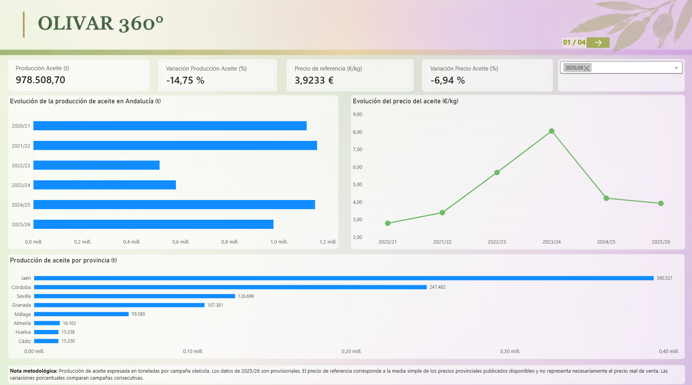
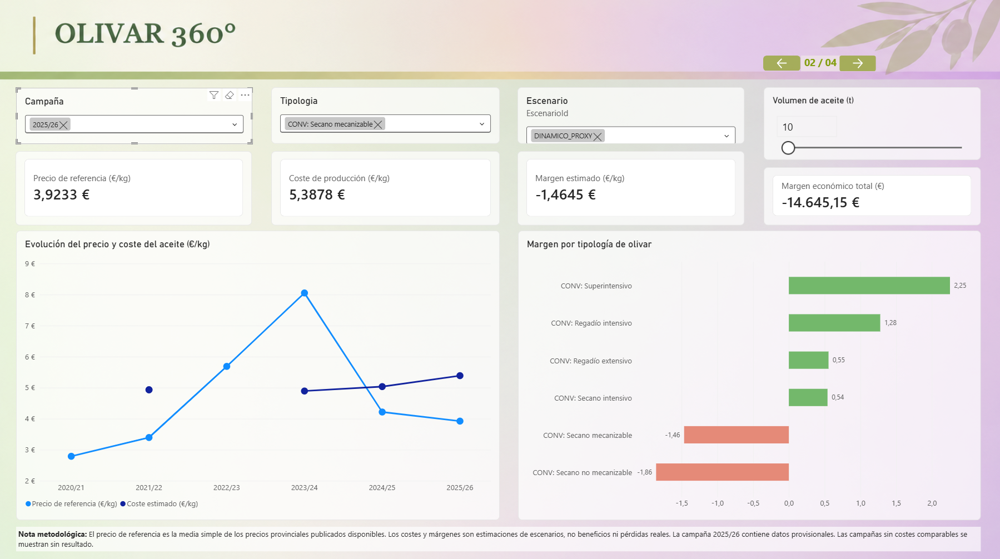
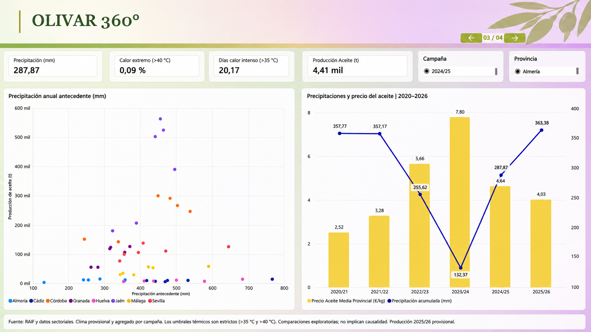
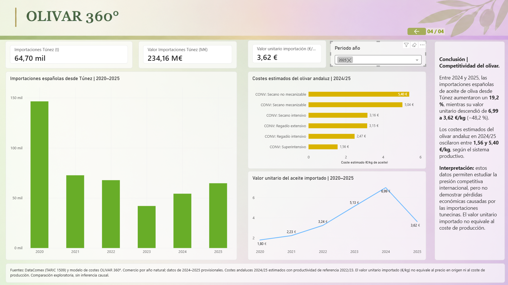

# OLIVAR 360°

**Análisis del sector oleícola andaluz (2020–2026)**  
*Portfolio de Data Analytics y Business Intelligence · Power BI · Python · SQL/DAX*

> **Estado:** Dashboard de cuatro páginas terminado y revisado visual y funcionalmente (noviembre de 2026). La auditoría de fuentes, supuestos y cálculos se documenta por separado; no debe interpretarse como certificación externa.

**Documentación técnica:** [Modelo Power BI, relaciones y DAX](docs/MODELO_POWER_BI.md) · [Python: instalación, uso y pruebas](scripts/README.md).

El inventario verificado de `OLIVAR_360_Simulador` registra **42 tablas, 62 relaciones y 40 objetos de medida**, de los cuales **39 tienen expresión y uno carece de ella**. El detalle del modelo distingue tablas de negocio, auxiliares y calendarios automáticos. Siguen pendientes la **agregación de lluvia con varias provincias** y la **validación final de la corrección decimal**; la revisión visual no cierra esos riesgos.

## Objetivo

Explorar cómo la variabilidad climática, la producción, los precios y la estructura de costes se relacionan con la situación económica del sector oleícola andaluz; añadir contexto de comercio internacional mediante las importaciones españolas de aceite de oliva desde Túnez.

**Ámbito:** ocho provincias andaluzas, campañas 2020/21–2025/26, y comercio por año natural 2020–2026 (2026 provisional). No se confunden campañas agrícolas con años naturales.

## Dashboard: cuatro páginas

| Página | Contenido |
| --- | --- |
| 01 · Panorama del sector | Producción regional y provincial, precios de referencia, tendencias y variaciones interanuales. |
| 02 · Costes y rentabilidad | Costes estimados €/kg, escenarios, márgenes estimados y simulador de volumen. |
| 03 · Clima, cosecha y precios | Precipitación, días de calor, producción y gráficos descriptivos de dispersión. |
| 04 · Competitividad del olivar | Importaciones españolas desde Túnez, valor unitario comercial y costes técnicos estimados de Andalucía. |

## Análisis reproducible con Python

El proyecto incorpora un script de análisis exploratorio de datos oleícolas desarrollado con Python y Pandas.

- **Validación de datos:** control de campañas, provincias, claves duplicadas y valores inválidos.
- **Análisis:** resumen de producción y precipitaciones y correlación regional exploratoria.
- **Reproducibilidad:** entrada Excel configurable, dependencias documentadas y pruebas automatizadas.
- **Calidad:** 18 pruebas superadas con datos sintéticos durante la preparación de la versión publicable.

**Código y guía de ejecución:** [Ver carpeta Python](scripts/README.md).

**Nota metodológica:** la correlación regional calculada por este script no equivale al análisis agroclimático ajustado documentado en el informe.

## Capturas del dashboard

### 01 · Panorama del sector

### 02 · Costes y rentabilidad

### 03 · Clima, cosecha y precios

### 04 · Competitividad del olivar

## Hallazgos ilustrativos

- Producción de aceite 2025/26: **978.508,70 t**, dato provisional; variación interanual mostrada en el dashboard: **−14,75 %**.
- Precio de referencia 2025/26: **3,9233 €/kg**; es la **media simple de los precios provinciales disponibles**, no un precio medio ponderado de transacciones.
- En 2024/25, seis tipologías del escenario de costes andaluz `DINAMICO_PROXY` muestran entre **1,56 y 5,40 €/kg**; **no** son costes reales observados.
- Importaciones españolas desde Túnez: **54.265 t** (2024) y **64.697 t** (2025), aproximadamente **+19,2 %**. El valor unitario pasa de **6,99 a 3,62 €/kg**, aproximadamente **−48,2 %**. Los dos años están etiquetados como provisionales en la fuente utilizada.
- En análisis agroclimático exploratorio, la asociación dentro de provincia entre lluvia anual antecedente y logaritmo de producción tuvo **r = +0,655**. La asociación no demuestra causalidad y **no corresponde directamente al scatter de valores absolutos del dashboard**.

## Metodología y cautelas

Leer [docs/METODOLOGIA.md](docs/METODOLOGIA.md), [docs/RESULTADOS_Y_LIMITACIONES.md](docs/RESULTADOS_Y_LIMITACIONES.md) y [docs/DICCIONARIO_BASICO.md](docs/DICCIONARIO_BASICO.md).

- Separación entre **aceituna agrícola**, **aceite producido**, **precios**, **costes estimados**, **series climáticas** y **comercio exterior**.
- Modelo dimensional de Power BI, con dimensiones de campaña, territorio y tipología; `FactComercioTunez` emplea año natural independiente.
- El coste de producción tunecino **no puede inferirse** a partir del valor unitario de importación; tampoco puede atribuirse una pérdida económica andaluza a esas importaciones con la evidencia disponible.
- Los datos de clima están sujetos a cobertura y controles de calidad; la cobertura de estaciones no equivale a representatividad de superficie de olivar.
- Los umbrales de temperatura y la escala de los porcentajes deben verificarse en el diccionario de la fuente y en las medidas DAX antes de la publicación definitiva.

## Tecnologías

Power BI Desktop, Power Query, DAX, Python/Pandas, pruebas automatizadas, Visual Studio Code y Git/GitHub.

## Reproducibilidad y acceso a los datos

El informe se construyó sobre archivos y scripts locales de trabajo. **Este paquete contiene documentación, capturas y un script Python con pruebas; no incluye los datos originales ni un `.pbix` verificado para redistribución.** La [guía de Python](scripts/README.md) describe la entrada autorizada necesaria y su ejecución; la [documentación del modelo](docs/MODELO_POWER_BI.md) recoge la estructura auditada, cinco expresiones DAX reales y los límites de reproducción. Si se decide añadir más código, datos autorizados o una versión publicable del PBIX, se revisarán licencias, procedencia, privacidad y tamaño antes de subirlos.

## Autoría y licencia

Proyecto de portfolio personal. **Licencia de código pendiente de decidir**: no se presupone autorización para redistribuir datasets de terceros ni se atribuye al usuario una licencia aún no elegida.
